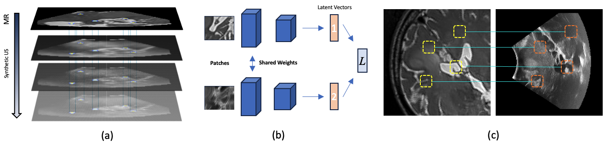

# Learning to Match 2D Keypoints Across Preoperative MR and Intraoperative Ultrasound

[](https://doi.org/10.1007/978-3-031-73647-6_8)
[](https://arxiv.org/abs/2409.08169)
[](LICENSE)
[](https://github.com/hassanrasheedk/crossfeat2d/actions/workflows/ci.yml)

Code for our paper at **ASMUS 2024** (5th International Workshop on Advances in Simplifying Medical Ultrasound, held with MICCAI 2024), which received the **ASMUS 2024 Best Presentation Award**.

[Hassan Rasheed](https://hassanrasheed.com), Reuben Dorent, Maximilian Fehrentz, Tina Kapur, William M. Wells III, Alexandra Golby, Sarah Frisken, Julia A. Schnabel, Nazim Haouchine

## Overview

During brain surgery the brain shifts, so the preoperative MR no longer lines up with the patient. Intraoperative ultrasound (US) shows the current anatomy, but it looks very different from MR, and standard keypoint descriptors find few reliable correspondences between the two.

We match keypoints **by synthesis**. From each patient's preoperative MR we generate many synthetic US images, covering several MR contrasts and the variability of intraoperative US. Because each synthetic image is pixel-aligned with its MR slice, every keypoint has a known correspondence. A small Siamese network is then trained **per patient** with a supervised contrastive loss and hard-negative mining, so that its descriptors capture structure and ignore texture and speckle.

On real cases from the [ReMIND](https://doi.org/10.1038/s41597-024-03295-z) dataset with ground truth, the paper reports an average matching precision of **80.35%**, outperforming the state-of-the-art methods compared against. These numbers come from the original notebooks; they have not been re-run since this code was refactored (see [Known limitations](#known-limitations)).



## Repository layout

```
src/crossfeat2d/      package: data, model, loss, matching, evaluation, CLI
tests/                CPU smoke tests on synthetic data (no ReMIND needed)
notebooks/
  training/           original training notebooks (main method + two ablations)
  evaluation/         original evaluation notebooks (LightGlue on real US; invariance tests)
  baselines/          SIFT, SuperPoint and MIND baselines
docs/                 method figure
```

The notebooks are the record of the thesis experiments, with outputs stripped and code unchanged. The `crossfeat2d` package is a cleaned-up port of the main training pipeline (`notebooks/training/train_siamese.ipynb`) and the real-US evaluation (`notebooks/evaluation/ours_lightglue.ipynb`), with the same defaults.

## Installation

Python 3.10 or newer. Install PyTorch for your platform first ([instructions](https://pytorch.org/get-started/locally/)), then:

```sh
git clone https://github.com/hassanrasheedk/crossfeat2d.git
cd crossfeat2d
pip install -e .              # package + CLI; pulls LightGlue v0.2 from GitHub
pip install -e ".[notebooks]" # extra dependencies to open the notebooks
```

SuperPoint and LightGlue weights are downloaded automatically on first use.

## Data

We use **ReMIND** (Juvekar et al., *Scientific Data* 11, 494, 2024), a public dataset of preoperative MR and intraoperative US from brain tumour resections. Download it from The Cancer Imaging Archive by following the [paper](https://doi.org/10.1038/s41597-024-03295-z), and check its terms of use. No patient data or model weights are stored in this repository.

The code expects each case as 2D PNG slices, with MR and US registered and resampled onto the same slice grid:

```
data/mr_us/Case067/
  t2/000.png ...                       T2 MR slices
  us/000.png ...                       registered intraoperative US slices (evaluation)
  synthetic_us/000-t2_0.3.png ...      synthetic US for slice 000 (training)
```

Synthetic images are named `<slice>-<MR contrasts>_<parameter>.png`, for example `000-t2_cet1_flair_0.5.png`; any `NNN-*.png` is used for slice `NNN`.

## Usage

Train a patient-specific descriptor on one case's synthetic US:

```sh
crossfeat2d train data/mr_us/Case067 --out runs/case067.pth --seed 0
```

Evaluate it on the same patient's real, registered US. A match counts as correct if it lands within ±4 px of the true location in x and y (on 192 px images); the reported number is the mean per-slice precision:

```sh
crossfeat2d evaluate data/mr_us/Case067 --weights runs/case067.pth --json runs/case067.json
```

`--matcher lightglue` (default) matches our descriptors with LightGlue's DISK weights, as in the paper's real-case evaluation; `--matcher cosine` uses nearest neighbours by cosine similarity with a ratio test. `crossfeat2d train --keypoints t2 --batch-size 256` runs the ablation that detects keypoints on the T2 slice instead of on each synthetic image (the ablation notebook also used only the `synthetic_us/t2flair` subset, selectable with `--synthetic-subdir`). See `crossfeat2d train -h` and `crossfeat2d evaluate -h` for all options.

The models are patient-specific by design, so no pretrained weights are provided; train one per case. A GPU is recommended, since a case with many synthetic images yields hundreds of thousands of patch pairs. Checkpoints saved by the original notebooks load directly.

The package can also be used from Python:

```python
from crossfeat2d import SiameseNetwork
from crossfeat2d.evaluate import match_slice
from crossfeat2d.io import load_image
from crossfeat2d.keypoints import build_superpoint
from crossfeat2d.matching import build_lightglue
```

## Development

```sh
pip install -e ".[dev]"
ruff check . && ruff format --check .
pytest
```

## Known limitations

These are properties of the original experiments, which the package keeps so that it reproduces them:

- **Train/validation split.** Pairs are shuffled and split 80/20 at the pair level, so patches from the same keypoint can appear in both sets and the validation loss is optimistic. The original runs used no fixed seed; the package adds `--seed`.
- **LightGlue setup.** LightGlue is used with weights trained for DISK descriptors (also 128-d), without retraining, and keypoints are normalised by their extent rather than by image size, as in the notebook.
- **Cosine matcher.** The notebooks' "one-to-one" filter compared positions in the match list rather than keypoint indices, so it never removed anything. The package's cosine matcher therefore allows several keypoints to match the same target.
- **Baselines.** `notebooks/baselines/mind_cosine.ipynb` indexes keypoints by their position in the filtered match list, which can mis-pair keypoints after similarity filtering. `superpoint_cosine.ipynb` uses `SuperPoint_Desc` from a locally modified LightGlue that is not available upstream.
- **Cosine matcher on real US.** `--matcher cosine` detects keypoints independently on both images and uses the ±4 px criterion, like the LightGlue evaluation. The invariance notebook (`ours_cosine_invariance.ipynb`) instead reused the MR keypoints on the synthetic image and required an exact match (margin 0), so the two sets of numbers are not comparable.
- **Images** are assumed to be 8-bit PNGs.
- **Verification.** After the refactor, the package was checked with unit tests and an end-to-end run on synthetic images only. The paper's numbers have not been reproduced with it.

## Citation

If you use this code, please cite:

```bibtex
@inproceedings{rasheed2024learning,
  title     = {Learning to Match 2D Keypoints Across Preoperative MR and Intraoperative Ultrasound},
  author    = {Rasheed, Hassan and Dorent, Reuben and Fehrentz, Maximilian and Kapur, Tina and Wells III, William M. and Golby, Alexandra and Frisken, Sarah and Schnabel, Julia A. and Haouchine, Nazim},
  booktitle = {Simplifying Medical Ultrasound (ASMUS 2024)},
  series    = {Lecture Notes in Computer Science},
  pages     = {78--87},
  publisher = {Springer},
  year      = {2024},
  doi       = {10.1007/978-3-031-73647-6_8}
}
```

and the ReMIND dataset:

```bibtex
@article{juvekar2024remind,
  title   = {{ReMIND}: The Brain Resection Multimodal Imaging Database},
  author  = {Juvekar, Parikshit and others},
  journal = {Scientific Data},
  volume  = {11},
  pages   = {494},
  year    = {2024},
  doi     = {10.1038/s41597-024-03295-z}
}
```

## Acknowledgements

This work was my master's thesis at the Technical University of Munich (TUM), carried out at Brigham and Women's Hospital / Harvard Medical School. It builds on [LightGlue and SuperPoint](https://github.com/cvg/LightGlue) (Apache-2.0).

## License

Code: [MIT](LICENSE). The ReMIND data and the LightGlue/SuperPoint weights have their own terms.
